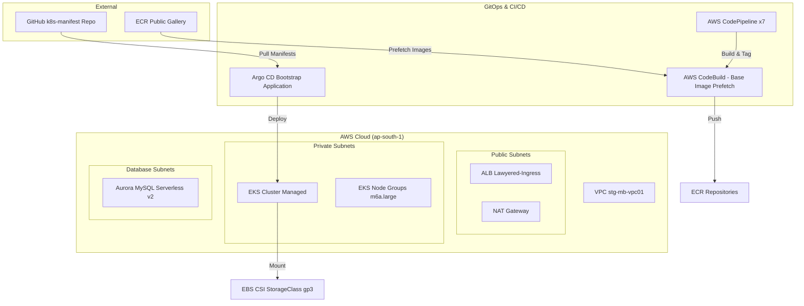

# 📜 Automated Infrastructure Journal

This file is automatically maintained by your AI assistant (Antigravity). It records every infrastructure change, command, and progress milestone in chronological order.

---

## 🗺️ Project Architecture Diagram



---

## 📂 File Structure Hierarchy

```text
resources/
├── k8s-manifest-staging/argocd_manifest/           # Argo CD Application Manifests (Managed by Terraform)
│   ├── infrastructure-storage/ # Cluster-wide resources (StorageClass)
│   ├── admin-lawyered.yaml
│   ├── api-challans.yaml
│   └── ... (microservice apps)
├── modules/                    # Reusable Terraform Infrastructure Modules
│   ├── argocd/                 # Helm-based Argo CD installation
│   ├── aurora/                 # Database cluster management
│   ├── codepipeline/           # CI/CD pipeline factory
│   ├── ecr/                    # Image repository management
│   ├── eks/                    # Core K8s cluster logic
│   └── eks-addons/             # CNI, CoreDNS, Procy, EBS CSI logic
├── templates/                  # Environment-specific configuration
│   ├── main.tf                 # Root orchestration and Bootstrap loop
│   ├── terraform.tfvars        # Deployment variables (VPC/Cluster maps)
│   └── backend.tf              # S3 Remote State configuration
├── JOURNAL.md                  # This Live Tracking File
└── README.md                   # Project Operations Manual
```

---

## 🗓️ April 24, 2026 - Milestone: "A to Y" Full Stack Automation

### **Task: EBS CSI Driver Installation**
- **Action**: Enabled the `aws-ebs-csi-driver` managed addon in `modules/eks-addons`.
- **Reason**: To support persistent storage and the `ebs-sc` (gp3) StorageClass for databases.
- **Outcome**: The cluster can now provision dynamic EBS volumes automatically.

### **Task: Manifest Bootstrap Loop**
- **Action**: Implemented a `kubectl_manifest` loop in `templates/main.tf` using the `fileset` function.
- **Reason**: To achieve "A to Z" (or "A to Y") automation where Terraform applies the Argo CD Applications directly.
- **Outcome**: All 7 microservices are now automatically registered in Argo CD upon `terraform apply`.

### **Task: Hybrid GitOps Strategy**
- **Action**: Decision to manage Application manifests in Terraform but keep Repository Credentials manual in the UI.
- **Reason**: Respecting the user's current security setup while automating the app delivery layer.
- **Outcome**: Simplified Terraform state and eliminated the need to handle sensitive SSH keys in code.

### **Task: Aurora Database Optimization (Infrastructure Hardening)**
- **Objective**: Standardize database settings and enable observability through automated logging.
- **Files Modified**: 
  - `modules/aurora/main.tf`: Added parameter group resources and logging configurations.
- **Detailed Actions**:
    - **Resource `aws_rds_cluster_parameter_group`**: Created `lawyered-database-cluster-pg` (family: `aurora-mysql8.0`). This governs cluster-level settings like replication and binary logging.
    - **Resource `aws_db_parameter_group`**: Created `lawyered-database-mysql-pg` (family: `aurora-mysql8.0`). This governs instance-level settings like memory usage and connection limits.
    - **Log Integration**: Enabled `enabled_cloudwatch_logs_exports` for `error` and `slowquery` in the `aws_rds_cluster` resource.
- **Logical Flow**: Terraform provisions the parameter groups first, then maps the Cluster PG to the DB Cluster and the Instance PG to each individual DB Instance.
- **Outcome**: Successfully generated a `terraform plan` showing a clean transition to managed parameter groups without resource destruction.

---

## 🗓️ April 23, 2026

### **Task: Pipeline Scaling**
- **Action**: Successfully scaled the CodePipeline module to 7 microservices.
- **Outcome**: 100% CI/CD coverage for the organization.

### **Task: Manual CI/CD Execution (QR API & API Challans)**
- **Date**: April 24, 2026
- **Action**: Manually triggered `qr-api-pipeline` and `api-challans-pipeline` via AWS CLI.
- **CD Sync**: User initiated manual sync via Argo CD UI to confirm microservice stability.
- **Outcome**: Successfully bypassed the commit-wait time for priority service updates.

---

## 🗓️ April 22, 2026

### **Task: Infrastructure Hardening**
- **Argo CD Ingress Refactoring**: Resolved circular provider dependencies.
- **Docker Hub 429 Fix**: Implemented ECR Public Gallery pre-fetching.
- **Framework Support**: Corrected Vite/React build paths and integrated Build Args.

---

## 🗓️ October 22, 2026

### **Task: challanpay-react Support Chat Build Variables & Dynamic Build Alignment**
- **Action**: 
  - Added support chat build arguments (`VITE_SUPPORT_CHAT_SCRIPT_URL`, `VITE_SUPPORT_CHAT_URL`, `VITE_SUPPORT_CHAT_ENABLED`) to `challanpay-react` in `resources/templates/terraform.tfvars`.
  - Removed hardcoded `custom_build_commands` override so the `codepipeline` module automatically and dynamically passes all defined `build_args` to `docker build`.
  - Successfully ran `terraform apply` updating `challanpay-react-pipeline-build` CodeBuild project in-place.
- **Outcome**: The CodeBuild buildspec now dynamically receives all 22 build arguments.
- **Resources Changed**: `aws_codebuild_project.this` for `challanpay-react`, `kubectl_manifest.argocd_bootstrap["argocd_manifest/stg-qr-api.yaml"]`.

---

## 🗓️ October 24, 2026

### **Task: challanpay-times Deployment Infrastructure & GitOps Integration**
- **Action**:
  - Provisioned `challanpay-times` ECR repository with automated image lifecycle policies.
  - Configured `challanpay-times` AWS CodePipeline with pre-fetching for `node:22-alpine` (ECR Public Gallery mirroring to prevent Docker Hub 429 errors), Next.js dynamic `build_args` (`NEXT_PUBLIC_API_BASE_URL`, `NEXT_PUBLIC_CHALLAN_CHECK_URL`), DevSecOps container security scan (Trivy), and gated GitOps manifest auto-update.
  - Created Kubernetes Deployment and ClusterIP Service manifests in `k8s-manifest-staging/deployments/stg-challanpay-times/` configured for Next.js standalone server on port 3000, non-root user `nextjs` (UID/GID 1001), health probes, resource limits, and external secret bindings.
  - Created Argo CD Application CRD `stg-challanpay-times.yaml` with automated sync, prune, and self-healing.
  - Configured dedicated AWS ALB Ingress `stg-challantimes-ingress.yaml` routing `staging.challantimes.in` traffic to `stg-challanpay-times`.
  - Added ExternalSecret `challanpay-times-secret` syncing secrets from AWS Secrets Manager key `staging/challanpay-times`.
  - Executed `terraform apply -auto-approve` successfully.
### **Task: challanpay-times AWS Secrets Manager Provisioning**
- **Action**:
  - Added `challanpay-times` to `local.stg_apps` in `resources/templates/main.tf` to bring it under Terraform management.
  - Created staging secret container `staging/challanpay-times` and version in AWS Secrets Manager (`ap-south-1`).
  - Seeded initial environment configuration (`NODE_ENV`, `NEXT_TELEMETRY_DISABLED`, `PORT`, `NEXT_PUBLIC_API_BASE_URL`, `NEXT_PUBLIC_CHALLAN_CHECK_URL`).
- **Outcome**: Secret `arn:aws:secretsmanager:ap-south-1:344367180480:secret:staging/challanpay-times-mQvG9s` is active and ready for External Secrets Operator (ESO) synchronization.

---

## 🗓️ October 27, 2026

### **Task: challanpay-times Revalidation Secret Configuration**
- **Action**:
  - Added `CHALLAN_TIMES_REVALIDATE_SECRET` build argument to `codepipelines.challanpay-times.build_args` in `resources/templates/terraform.tfvars`.
  - Executed `terraform plan` to verify CodeBuild project buildspec update and environment variable mapping.
  - Executed `terraform apply -auto-approve` successfully updating `challanpay-times-pipeline-build` CodeBuild project in-place.
- **Outcome**: CodeBuild project now passes `CHALLAN_TIMES_REVALIDATE_SECRET` as an environment variable and injects it into `docker build --build-arg`.

---

## 🗓️ November 2, 2026

### **Task: lots247-website Deployment Files**
- **Action**:
  - Added `lots247-website` ECR repository and CodePipeline to `resources/templates/terraform.tfvars`, and to `local.stg_apps` in `resources/templates/main.tf`.
  - Set `NEXT_PUBLIC_CMS_API_BASE_URL` and `NEXT_PUBLIC_LOTS_SITE_URL` as pipeline `build_args`, because the Dockerfile defaults them to production.
  - Created Deployment, Service and HPA manifests in `k8s-manifest-staging/deployments/stg-lots247-website/` for the Next.js standalone server on port 3000, running as the image's `node` user (UID/GID 1000).
  - Created Argo CD Application `stg-lots247-website.yaml`, ALB Ingress `stg-lots247-website-ingress.yaml` for `staging-website.lots247.in`, and ExternalSecret `lots247-website-secret`.
- **Outcome**: Files created. `terraform apply` and the `k8s-manifest` push have not been run yet. This app runs alongside `lots247-in` and does not replace it.

---

## 🗓️ November 3, 2026

### **Task: lots247-website Build Environment Variables Configuration**
- **Action**:
  - Added frontend environment variables (`VITE_APP_BASE_PATH`, `VITE_LOTS247_ORIGIN`, `VITE_DASHBOARD_LOGIN_URL`, `VITE_REGISTER_BASE_URL`, `VITE_CMS_API_BASE_URL`) to `codepipelines.lots247-website.build_args` in `resources/templates/terraform.tfvars`.
  - Executed `terraform plan` to verify CodeBuild project `lots247-website-pipeline-build` environment variables and buildspec Docker build argument mapping.
  - Executed `terraform apply -auto-approve` successfully updating `lots247-website-pipeline-build` CodeBuild project in-place.
- **Outcome**: The CodeBuild project now injects all 7 build arguments (`NEXT_PUBLIC_CMS_API_BASE_URL`, `NEXT_PUBLIC_LOTS_SITE_URL`, `VITE_APP_BASE_PATH`, `VITE_LOTS247_ORIGIN`, `VITE_DASHBOARD_LOGIN_URL`, `VITE_REGISTER_BASE_URL`, `VITE_CMS_API_BASE_URL`) into `docker build --build-arg`.
- **Resources Changed**: `aws_codebuild_project.this` for `lots247-website`.

### **Task: lots247-in (lots247.com-website) Build Variables Configuration & Re-alignment**
- **Action**:
  - Configured `VITE_*` environment variables (`VITE_APP_BASE_PATH`, `VITE_LOTS247_ORIGIN`, `VITE_DASHBOARD_LOGIN_URL`, `VITE_REGISTER_BASE_URL`, `VITE_CMS_API_BASE_URL`) under `codepipelines.lots247-in` in `resources/templates/terraform.tfvars` targeting repository `Lawyered-in/lots247.com-website`.
  - Reverted `lots247-website` back to Next.js specific build parameters (`NEXT_PUBLIC_CMS_API_BASE_URL`, `NEXT_PUBLIC_LOTS_SITE_URL`).
  - Executed `terraform apply -auto-approve` updating both `lots247-in-pipeline-build` and `lots247-website-pipeline-build` in-place.
- **Outcome**: `lots247-in` now passes the required `VITE_*` arguments during Docker build; `lots247-website` state is restored cleanly.
- **Resources Changed**: `aws_codebuild_project.this` for `lots247-in`, `aws_codebuild_project.this` for `lots247-website`.

---

## 🗓️ November 11, 2026

### **Task: expert-app (Lawyered-in/new-expert-app) Deployment Files**
- **Action**:
  - Added `expert-app` ECR repository and CodePipeline (`staging` branch) to `resources/templates/terraform.tfvars`. `EXPO_PUBLIC_API_URL=https://staging-be.lawyered.in/api/v1` is passed as a build arg because Expo inlines it into the bundle at build time.
  - Used `custom_pre_build_commands` to prefetch `node:22.21.1-bookworm-slim` from `public.ecr.aws/docker/library` and `nginxinc/nginx-unprivileged:1.28.0-alpine` from `public.ecr.aws/nginx`. The default prefetch loop only covers Docker Hub official images.
  - Used `custom_build_commands` with `DOCKER_BUILDKIT=1 --target runtime`, because the Dockerfile uses `RUN --mount=type=cache`. Build compute is `BUILD_GENERAL1_MEDIUM` so Metro bundling does not run out of memory.
  - Created Deployment, Service and HPA in `k8s-manifest-staging/deployments/stg-expert-app/`: nginx-unprivileged on port 8080, UID/GID 101, read-only root filesystem with a `/tmp` emptyDir, and `/healthz` probes.
  - Created Argo CD Application `stg-expert-app.yaml` and ALB Ingress `stg-expert-app-ingress.yaml` for `staging-experts.lawyered.in` (group order 20, `*.lawyered.in` certificate).
  - No ExternalSecret and no `stg_apps` entry: the image serves static files only and reads no runtime env.
- **Outcome**: `terraform apply` succeeded: 13 added, 0 changed, 0 destroyed. Created the ECR repo, the CodePipeline (build, Trivy scan and gated deploy CodeBuild projects, IAM roles and policies, artifact S3 bucket) and the Argo CD Application `stg-expert-app`. The first pipeline run started on creation. The `k8s-manifest` push, the ingress apply and the DNS record are still pending.
- **Resources Changed**: `module.ecr["expert-app"]`, `module.codepipeline["expert-app"]`, `kubectl_manifest.argocd_bootstrap["argocd_manifest/stg-expert-app.yaml"]`.

### **Task: expert-app AWS Secrets Manager Provisioning**
- **Action**:
  - Added `expert-app` to `local.stg_apps` in `resources/templates/main.tf`.
  - Seeded `resources/templates/secrets/expert-app.json` (gitignored) with `NODE_ENV`, `EXPO_NO_TELEMETRY`, `PORT`, `EXPO_PUBLIC_API_URL`.
  - Ran `terraform apply` (2 added, 0 changed, 0 destroyed).
- **Outcome**: Secret `arn:aws:secretsmanager:ap-south-1:344367180480:secret:staging/expert-app-h0hRIb` is active. No ExternalSecret is wired yet; the nginx image reads no runtime env, and `EXPO_PUBLIC_API_URL` still has to be set through the pipeline build args.

---
*Next entries will be appended automatically as we work.*

